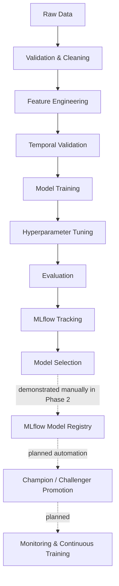

# MiBici MLOps — Hourly Bike Demand Forecasting

A collaborative Machine Learning and MLOps project for forecasting **hourly bike-trip demand by origin station** using historical data from MiBici, Guadalajara's public bicycle-sharing system.

The project was developed by **Team 16** as part of the *TC5044 — Machine Learning Operations* course in the Master's in Applied Artificial Intelligence program. Its focus is not only model accuracy, but also reproducibility, temporal validation, experiment tracking, model comparison, and an incremental path toward production-oriented MLOps practices.

> **Current status:** the public `main` branch includes data preparation, feature engineering, model training, temporal validation, hyperparameter tuning, model evaluation, and MLflow experiment tracking. Model Registry usage was demonstrated during Phase 2, while automated registration, inference, monitoring, deployment, and continuous training remain ongoing or planned work.

---

## Project Overview

MiBici publishes historical trip records that can be transformed into a station-by-hour demand signal. This project builds a reproducible workflow to estimate the number of trips expected to start at each station during a given hour.

The project evolved in two main stages:

- **Phase 1:** data auditing, cleaning, temporal normalization, feature preparation, and a reproducible baseline workflow.
- **Phase 2:** temporal train/test splitting, multiple regression models, hyperparameter tuning with time-aware validation, MLflow experiment tracking, model comparison, and champion-model selection.

The current repository is structured using a Cookiecutter Data Science-style layout and separates data preparation, feature engineering, modeling, reports, and tests.

---

## Business Problem

Bike-sharing demand varies significantly by station, hour of day, day of week, month, weekend/weekday behavior, and recent station-level demand.

Operationally, this variability can produce stations with too few available bicycles or stations where bicycles accumulate.

The Machine Learning problem is therefore formulated as:

> **Predict the number of trips initiated at each station for a given hour using only information available before the prediction time.**

The expected business value is to support operational planning and help identify stations and periods that may require closer attention or future redistribution actions.

The final operational decision remains outside the model and should stay with the corresponding operations team.

---

## Solution Architecture


### Current workflow



---

## Technology Stack

| Area | Technologies |
|---|---|
| Language | Python 3.11 |
| Data Processing | pandas, NumPy, Parquet |
| Machine Learning | scikit-learn |
| Modeling | DummyRegressor, Ridge, SGDRegressor, TruncatedSVD |
| Preprocessing | ColumnTransformer, OneHotEncoder, StandardScaler |
| Validation & Tuning | TimeSeriesSplit, GridSearchCV |
| Experiment Tracking | MLflow 3.16.1 |
| CLI / Utilities | Typer, Loguru |
| Testing & Quality | pytest, flake8, black, isort |
| Collaboration | Git, GitHub, feature branches, Pull Requests |

---

## Data Pipeline & Feature Engineering

### Data preparation

The data preparation workflow in `mibici/dataset.py`:

1. Recursively discovers MiBici CSV files matching `datos_abiertos_*.csv`.
2. Handles known date-format differences across source periods.
3. Normalizes inconsistent birth-year column encodings.
4. Standardizes column names.
5. Removes logically invalid trips where the trip end time is earlier than the start time.
6. Writes the cleaned dataset as Parquet.
7. Logs the resulting dataset artifact in MLflow.

During the Phase 1 audit, the team reviewed:

- **24 CSV files**
- approximately **9.18 million historical trip records**
- multiple date formats across source files
- inconsistent encodings of the birth-year column
- duplicate and temporal-integrity conditions relevant to the modeling objective

### Feature engineering

`mibici/features.py` builds the modeling dataset at **origin station × hour** granularity.

| Feature | Description |
|---|---|
| `origen_id` | Origin station identifier |
| `hora` | Hour of day |
| `dia_semana` | Day of week |
| `mes` | Month |
| `es_fin_de_semana` | Weekend indicator |
| `demanda_lag_1h` | Demand observed one hour earlier |
| `demanda_lag_24h` | Demand observed at the same hour one day earlier |

The pipeline also injects zero-demand hours within each station's active period so that missing hourly observations are not automatically interpreted as missing records.

### Leakage prevention

Historical-demand features are generated using `groupby(...).shift(...)`, so the model uses only past demand values:

- `shift(1)` for the previous hour,
- `shift(24)` for the same hour on the previous day.

This prevents direct use of future target values during training.

---

## Model Training & Evaluation

The model-training workflow is implemented in `mibici/modeling/train.py`.

### Preprocessing

A scikit-learn `ColumnTransformer` applies:

- `OneHotEncoder(handle_unknown="ignore")` to categorical features,
- `StandardScaler()` to numerical lag features,
- passthrough for the weekend indicator.

Preprocessing and estimation are combined into scikit-learn `Pipeline` objects.

### Temporal validation

The current implementation uses a chronological train/test split with:

```text
cutoff_date = 2026-08-01
```

Hyperparameter tuning uses:

```python
TimeSeriesSplit(n_splits=3)
```

instead of random cross-validation, reducing the risk of temporal leakage.

### Models evaluated

Five configurations were compared:

1. DummyRegressor — mean strategy
2. DummyRegressor — median strategy
3. Ridge Regression
4. SGDRegressor
5. Ridge + TruncatedSVD

Ridge and SGDRegressor use `GridSearchCV` for hyperparameter tuning.

---

## Results & Key Findings

Results currently stored in `reports/baseline_results.csv`:

| Model | Configuration | MAE | RMSE |
|---|---|---:|---:|
| DummyRegressor | `strategy=mean` | 1.5612 | 2.5714 |
| DummyRegressor | `strategy=median` | 1.2982 | 2.8805 |
| **Ridge** | `alpha=100.0` | 0.9605 | **1.6628** |
| SGDRegressor | `alpha=0.001` | 0.9901 | 1.7096 |
| Ridge + TruncatedSVD | `alpha=100.0, n_components=50` | **0.9513** | 1.6932 |

### Main findings

- All trained models outperform the dummy baselines.
- **Ridge achieved the lowest RMSE (`1.6628`)** and was selected as the primary model based on the project's main evaluation criterion.
- **Ridge + TruncatedSVD achieved the lowest MAE (`0.9513`)**, but its RMSE was slightly higher than Ridge.
- Dimensionality reduction improved MAE slightly, but not enough to replace the simpler Ridge solution under the selected RMSE criterion.
- The results illustrate the importance of comparing multiple metrics rather than selecting a model from a single score.

---

## MLflow Experiment Tracking & Model Registry

### Experiment Tracking — implemented

The training workflow logs:

- model type,
- hyperparameters,
- temporal split configuration,
- cutoff date,
- feature list,
- MAE,
- RMSE,
- training-row count,
- test-row count,
- serialized scikit-learn pipeline.

Feature engineering and data preparation also create MLflow runs and log dataset-related artifacts or metadata.

### Model Registry — demonstrated, not yet automated from `train.py`

During Phase 2, the team used MLflow Model Registry to version candidate models and work with **champion/challenger aliases**.

However, the current public `main` implementation logs models using:

```python
mlflow.sklearn.log_model(
    model,
    name="model",
)
```

The model is **not currently registered automatically from the training code** with `registered_model_name`.

This is a known improvement identified during the course review.

Planned flow:

```text
Training run
    ↓
Register new model version
    ↓
Evaluate as challenger
    ↓
Compare against current champion
    ↓
Promote only if the challenger passes the defined quality gate
```

---

## MLOps Workflow

### Implemented

- Modular data preparation
- Modular feature engineering
- Reproducible scikit-learn preprocessing and training pipeline
- Temporal train/test separation
- Time-aware cross-validation
- Hyperparameter tuning
- Multiple-model comparison
- MAE and RMSE evaluation
- MLflow experiment tracking
- Serialized model artifacts
- Git-based collaboration through branches and Pull Requests

### Demonstrated / partially automated

- MLflow Model Registry
- Model versioning
- Champion/challenger aliases

### Planned / in progress

- Automatic model registration from training code
- Automated champion/challenger promotion gates
- Production-ready batch inference
- Data and model drift monitoring with Evidently
- Model-performance monitoring
- A/B or shadow/canary evaluation strategies
- Continuous Training triggers
- CI/CD automation for model workflows
- Production deployment / serving

---

## Reproducibility / Getting Started

### Requirements

- Python **3.11**
- Git
- Local storage for MiBici source data

### 1. Clone the repository

```bash
git clone https://github.com/ISC-Ignacio-Naranjo/mibici.git
cd mibici
```

### 2. Create and activate a virtual environment

```bash
python3.11 -m venv .venv
source .venv/bin/activate
```

On Windows:

```powershell
.venv\Scripts\activate
```

### 3. Install the project

```bash
pip install -e .
```

or:

```bash
make requirements
```

### 4. Add the source data

Place the MiBici historical CSV files under:

```text
data/raw/
```

Nested folders are supported because the current loader performs a recursive search for:

```text
datos_abiertos_*.csv
```

The raw data is not included in this repository.

### 5. Run data preparation

```bash
make data
```

Equivalent command:

```bash
python mibici/dataset.py
```

Expected output:

```text
data/interim/mibici_cleaned.parquet
```

### 6. Build modeling features

```bash
python mibici/features.py
```

Expected output:

```text
data/processed/mibici_features.parquet
```

### 7. Train and evaluate models

```bash
python mibici/modeling/train.py
```

The workflow evaluates the configured baselines and candidate models and writes the comparison to:

```text
reports/baseline_results.csv
```

### 8. Open MLflow

```bash
mlflow ui
```

Then open:

```text
http://127.0.0.1:5000
```

### 9. Run tests

```bash
make test
```

### 10. Run code-quality checks

```bash
make lint
```

---

## Repository Structure

```text
mibici/
├── data/
│   ├── external/
│   ├── interim/
│   ├── processed/
│   └── raw/
├── docs/
├── mibici/
│   ├── config.py
│   ├── dataset.py
│   ├── features.py
│   ├── modeling/
│   │   ├── __init__.py
│   │   ├── predict.py
│   │   └── train.py
│   └── plots.py
├── models/
├── notebooks/
├── references/
├── reports/
│   ├── baseline_results.csv
│   └── figures/
├── tests/
├── Makefile
├── pyproject.toml
└── README.md
```

> **Note:** `mibici/modeling/predict.py` and `mibici/plots.py` still contain scaffold/template code in the current public `main` branch. Production inference and finalized visualization utilities should therefore not be considered implemented capabilities yet.

---

## Project Status & Roadmap

| Capability | Status |
|---|---|
| Data audit and cleaning | ✅ Implemented |
| Parquet-based intermediate dataset | ✅ Implemented |
| Station-hour demand construction | ✅ Implemented |
| Temporal feature engineering | ✅ Implemented |
| Lag features | ✅ Implemented |
| Leakage-aware temporal validation | ✅ Implemented |
| Scikit-learn preprocessing pipeline | ✅ Implemented |
| Multiple regression models | ✅ Implemented |
| Hyperparameter tuning | ✅ Implemented |
| MAE / RMSE model comparison | ✅ Implemented |
| MLflow Experiment Tracking | ✅ Implemented |
| MLflow model artifacts | ✅ Implemented |
| Model Registry workflow | 🟡 Demonstrated manually |
| Champion / challenger aliases | 🟡 Demonstrated manually |
| Automated Registry integration | 🔵 Planned |
| Production batch inference | 🔵 Planned |
| Drift monitoring with Evidently | 🔵 Planned / course final phase |
| A/B / shadow / canary evaluation | 🔵 Planned |
| Continuous Training | 🔵 Planned |
| CI/CD for ML workflows | 🔵 Planned |
| Production deployment | 🔵 Planned |

Legend:

- ✅ **Implemented** — present in the current public codebase.
- 🟡 **Demonstrated / partial** — used during the project but not yet fully automated in the public workflow.
- 🔵 **Planned** — roadmap item; not presented as a completed capability.

---

## Engineering Decisions

### Why temporal validation?

Random train/test splits can leak future patterns into training for time-dependent demand data. This project therefore uses chronological separation and `TimeSeriesSplit` during tuning.

### Why Ridge as the selected model?

Ridge produced the lowest RMSE among the evaluated configurations while remaining simpler than the Ridge + TruncatedSVD pipeline.

### Why keep both MAE and RMSE?

MAE provides an intuitive average absolute error, while RMSE penalizes larger errors more strongly. Using both prevents model selection from relying on a single view of performance.

### Why MLflow?

MLflow provides a structured way to preserve experiment parameters, metrics, datasets, artifacts, and model outputs across multiple training runs.

---

## Known Limitations

This project is an evolving academic MLOps implementation rather than a production deployment.

Current limitations include:

- no production-serving endpoint,
- no completed inference pipeline in `predict.py`,
- Model Registry registration is not yet automated from `train.py`,
- monitoring and drift detection are not yet integrated into `main`,
- no automated Continuous Training workflow,
- no production SLA/SLO or real-time service monitoring,
- no external variables such as weather or events in the current model.

These limitations are documented intentionally so that the repository reflects the actual implementation rather than an aspirational architecture.

---

## Contributors

This is a **collaborative Team 16 project** developed for TC5044 — Machine Learning Operations.

- José Ignacio Naranjo Guerra
- Alejandro Ojeda Zazueta
- José Miguel Muñiz Apresa
- Moisés Oliva González

Contributions were developed collaboratively through Git branches, commits, and Pull Requests. The repository and this README intentionally describe the project at team level rather than assigning shared implementations to a single contributor.

---

## Academic Context

**Course:** TC5044 — Machine Learning Operations  
**Program:** Master's in Applied Artificial Intelligence  
**Institution:** Tecnológico de Monterrey

The project uses MiBici open historical trip data for academic and educational purposes.

---

## Next Steps

The highest-priority technical improvements are:

1. register trained models in MLflow Model Registry directly from code;
2. automate champion/challenger evaluation and promotion criteria;
3. replace the current `predict.py` scaffold with a reproducible inference workflow;
4. integrate data/model monitoring and drift detection;
5. define Continuous Training triggers and retraining gates;
6. add CI/CD automation only after the training and monitoring workflow is stable.

These steps extend the existing implementation without changing the core prediction problem or overstating the current maturity of the system.
