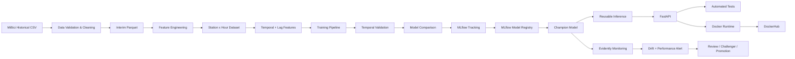
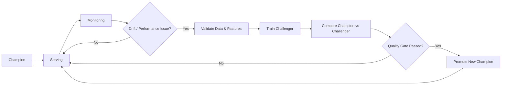

# MiBici MLOps — Hourly Bike Demand Forecasting

An end-to-end Machine Learning and MLOps project for forecasting **hourly bike-trip demand by origin station** using historical data from MiBici, Guadalajara's public bicycle-sharing system.

The project was developed by **Team 16** as part of **TC5044 — Machine Learning Operations** in the Master's in Applied Artificial Intelligence program at Tecnológico de Monterrey.

The final implementation goes beyond model training: it integrates data preparation, feature engineering, temporal validation, model comparison, MLflow tracking and registry, reusable inference, FastAPI serving, automated testing, reproducibility validation, Docker packaging, DockerHub distribution, and synthetic data-drift/performance monitoring.

> **Final course-delivery status:** the `main` branch contains the integrated Phase 1, Phase 2, and Final Delivery workflow. The selected Ridge model is served through FastAPI, validated through automated tests, packaged in Docker, published to DockerHub, and evaluated under a synthetic network-expansion + cold-start drift scenario.

---

## Project Overview

MiBici publishes historical trip records that can be transformed into a station-by-hour demand signal. This project builds a reproducible workflow to estimate the number of trips expected to start at each station during a given hour.

The project evolved through three stages:

- **Phase 1 — Data and pipeline foundation:** data auditing, cleaning, temporal normalization, feature preparation, a reproducible baseline workflow, and initial MLflow tracking.
- **Phase 2 — Modeling and governance:** chronological train/test splitting, multiple regression models, hyperparameter tuning with time-aware validation, MLflow experiment tracking, model comparison, and champion-model selection.
- **Final Delivery — Serving and monitoring:** reusable inference, FastAPI, clean-environment reproducibility, unit/integration/API tests, Docker/DockerHub, and synthetic data-drift + performance-degradation monitoring.

The repository follows a Cookiecutter Data Science-style organization and separates data preparation, feature engineering, modeling, serving, monitoring, tests, reports, and deployment artifacts.

---

## Business Problem

Bike-sharing demand varies by station, hour of day, day of week, month, weekend/weekday behavior, and recent station-level demand.

Operationally, this variability can produce stations with too few available bicycles or stations where bicycles accumulate.

The Machine Learning problem is formulated as:

> **Predict the number of trips initiated at each station for a given hour using only information available before the prediction time.**

The expected value is to support operational planning by identifying stations and periods with higher expected activity and helping prioritize future redistribution or review actions.

The final operational decision remains outside the model and should stay with the corresponding operations team.

---

## End-to-End MLOps Architecture



### Operational feedback loop



---

## Technology Stack

| Area | Technologies |
|---|---|
| Language | Python 3.11.2 |
| Data Processing | pandas, NumPy, Parquet |
| Machine Learning | scikit-learn |
| Modeling | DummyRegressor, Ridge, SGDRegressor, TruncatedSVD |
| Preprocessing | ColumnTransformer, OneHotEncoder, StandardScaler |
| Validation & Tuning | TimeSeriesSplit, GridSearchCV |
| Experiment Tracking | MLflow 3.16.1 |
| Model Governance | MLflow Model Registry, champion/challenger aliases |
| API / Serving | FastAPI 0.143.3, Uvicorn 0.54.0, Pydantic 2.14.1 |
| Testing | pytest |
| Monitoring | Evidently 0.7.23 |
| Containerization | Docker |
| Container Registry | DockerHub |
| Collaboration | Git, GitHub, feature branches, Pull Requests |

---

## Data Pipeline & Feature Engineering

### Data preparation

The workflow in `mibici/dataset.py`:

1. Recursively discovers MiBici CSV files matching `datos_abiertos_*.csv`.
2. Handles known date-format differences across source periods.
3. Normalizes inconsistent birth-year column encodings.
4. Standardizes column names.
5. Removes logically invalid trips where the trip end time is earlier than the start time.
6. Writes the cleaned dataset as Parquet.
7. Logs the resulting dataset artifact in MLflow.

During Phase 1, the team audited:

- **24 CSV files**
- approximately **9.18 million historical trip records**
- multiple date formats across source files
- inconsistent birth-year column encodings
- duplicate and temporal-integrity conditions relevant to the modeling objective

The cleaning strategy intentionally preserves trips with missing birth-year information when those records still contain the fields required to construct station-hour demand.

### Feature engineering

`mibici/features.py` builds the modeling dataset at **origin station × hour** granularity.

| Feature | Description |
|---|---|
| `origen_id` | Origin station identifier |
| `hora` | Hour of day |
| `dia_semana` | Day of week |
| `mes` | Month |
| `es_fin_de_semana` | Weekend indicator |
| `demanda_lag_1h` | Demand observed one hour earlier |
| `demanda_lag_24h` | Demand observed at the same hour one day earlier |

The pipeline also injects zero-demand hours within each station's active period so missing hourly observations are not automatically interpreted as missing records.

### Leakage prevention

Historical-demand features use station-level shifts:

- `shift(1)` for the previous hour
- `shift(24)` for the same hour on the previous day

Only information available before the prediction time is used.

---

## Model Training & Evaluation

The training workflow is implemented in `mibici/modeling/train.py`.

### Preprocessing

A scikit-learn `ColumnTransformer` applies:

- `OneHotEncoder(handle_unknown="ignore")` to categorical features
- `StandardScaler()` to numerical lag features
- passthrough for the weekend indicator

Preprocessing and estimation are combined into scikit-learn `Pipeline` objects so the same transformation logic is preserved across training and inference.

### Temporal validation

The implementation uses a chronological train/test split:

```text
cutoff_date = 2026-08-01
```

Final split sizes:

- **Train:** 2,752,439 rows
- **Test:** 680,570 rows

Hyperparameter tuning uses:

```python
TimeSeriesSplit(n_splits=3)
```

instead of random cross-validation, reducing temporal leakage risk.

### Models evaluated

Five configurations were compared:

1. DummyRegressor — mean strategy
2. DummyRegressor — median strategy
3. Ridge Regression
4. SGDRegressor
5. Ridge + TruncatedSVD

Ridge and SGDRegressor use `GridSearchCV` for hyperparameter tuning.

---

## Results & Champion Model

Results stored in `reports/baseline_results.csv`:

| Model | Configuration | MAE | RMSE |
|---|---|---:|---:|
| DummyRegressor | `strategy=mean` | 1.5612 | 2.5714 |
| DummyRegressor | `strategy=median` | 1.2982 | 2.8805 |
| **Ridge** | `alpha=100.0` | **0.9605** | **1.6628** |
| SGDRegressor | `alpha=0.001` | 0.9901 | 1.7096 |
| Ridge + TruncatedSVD | `alpha=100.0, n_components=50` | **0.9513** | 1.6932 |

### Main findings

- All trained models outperform the dummy baselines.
- **Ridge achieved the lowest RMSE (`1.6628`)** and was selected as the champion under the project's primary evaluation criterion.
- Ridge + TruncatedSVD achieved the lowest MAE (`0.9513`) but a slightly worse RMSE.
- Dimensionality reduction did not improve overall performance enough to justify replacing the simpler Ridge solution.

---

## MLflow Tracking & Model Registry

### Experiment Tracking

The training workflow logs:

- model type
- hyperparameters
- temporal split configuration
- cutoff date
- feature list
- MAE
- RMSE
- training-row count
- test-row count
- serialized scikit-learn pipeline

### Model Registry

The project uses the registered model:

```text
mibici_demand_model
```

The final demonstrated registry state includes champion/challenger aliases, with inference configured to load:

```text
models:/mibici_demand_model@champion
```

This decouples the service from a hard-coded model version.

> **Current limitation:** model registration is not yet automatically triggered from `train.py` using a promotion gate. Registry automation remains future work.

---

## Reusable Inference

Reusable inference is implemented in:

```text
mibici/modeling/predict.py
```

Main responsibilities:

- `load_model(model_uri)` — loads an MLflow model
- `prepare_input(data)` — validates and prepares required feature columns
- `predict_demand(model, data)` — executes inference using the complete serialized pipeline

The default model URI is externalized through configuration:

```text
MODEL_URI=models:/mibici_demand_model@champion
```

This allows local development to use the MLflow Registry while Docker can point to a model bundled inside the image.

---

## FastAPI Serving

The service is implemented in:

```text
mibici/api.py
```

### Endpoints

| Method | Endpoint | Purpose |
|---|---|---|
| GET | `/health` | Process-level health check |
| GET | `/ready` | Confirms the model is loaded and ready |
| POST | `/predict` | Returns hourly demand prediction |
| GET | `/docs` | Swagger / OpenAPI UI |

### Run locally

A local MLflow Registry containing the champion model is required when using the default registry URI.

```bash
uvicorn mibici.api:app --host 0.0.0.0 --port 8000
```

Swagger:

```text
http://localhost:8000/docs
```

### Example request

```json
{
  "origen_id": 2,
  "hora": 6,
  "dia_semana": 3,
  "mes": 10,
  "demanda_lag_1h": 0.0,
  "demanda_lag_24h": 2.0,
  "es_fin_de_semana": 0
}
```

Reference response:

```json
{
  "predicted_demand": 1.448516592637294,
  "model_uri": "models:/mibici_demand_model@champion"
}
```

Pydantic validates input ranges before inference. For example, an invalid `hora=30` request returns HTTP `422`.

---

## Automated Testing

The final testing suite covers:

- feature-engineering behavior
- `lag_1h` and `lag_24h` calculation
- `/health`
- `/ready`
- valid `/predict`
- invalid request validation
- integration behavior across project components

Final validation reported **6 tests passing**.

Run the suite with:

```bash
python -m pytest -q
```

Final testing work was reviewed through **PR #12** and integrated into `main`.

---

## Reproducibility Validation

The deployable model/service was validated in a clean virtual environment using pinned dependencies.

### Validated runtime

| Component | Version |
|---|---:|
| Python | 3.11.2 |
| FastAPI | 0.143.3 |
| Uvicorn | 0.54.0 |
| Pydantic | 2.14.1 |
| MLflow | 3.16.1 |
| NumPy | 2.4.6 |
| pandas | 3.0.6 |
| scikit-learn | 1.9.1 |

The same reference input produced exactly the same prediction in the original and clean runtime:

```text
Original prediction     = 1.448516592637294
Clean-runtime prediction = 1.448516592637294
Absolute difference      = 0.0
```

Reproducibility mechanisms include:

- pinned runtime dependencies
- serialized MLflow model artifact
- complete scikit-learn preprocessing + estimator pipeline
- externalized `MODEL_URI`
- clean-environment validation
- deterministic monitoring sample (`random_state=42`)

---

## Docker & DockerHub

The final API is packaged into a Docker image containing the service dependencies and an exported MLflow champion model.

This makes the container self-contained for inference and avoids requiring an external MLflow Registry server at runtime.

### Build locally

From the repository root:

```bash
docker build -t mibici-api:1.0.0 .
```

Run:

```bash
docker run --rm -p 8000:8000 mibici-api:1.0.0
```

Validate:

```text
http://localhost:8000/health
http://localhost:8000/ready
http://localhost:8000/docs
```

### Published image

DockerHub:

```text
miguelmuniz1/mibici-api:1.0.0
```

Pull:

```bash
docker pull miguelmuniz1/mibici-api:1.0.0
```

Run:

```bash
docker run --rm -p 8000:8000 miguelmuniz1/mibici-api:1.0.0
```

DockerHub repository:

https://hub.docker.com/r/miguelmuniz1/mibici-api

The reference Docker prediction also produced:

```text
1.448516592637294
```

with an absolute difference of `0.0` against the validated reference output.

---

## Data Drift & Performance Monitoring

Monitoring is implemented in:

```text
mibici/monitoring/drift.py
```

using **Evidently 0.7.23**.

### Observed coverage change

Using the temporal cutoff:

```text
2026-08-01
```

the project observed:

- **452** stations represented during training
- **469** stations represented post-cutoff
- **18 `origen_id` values** post-cutoff that were unseen during training

`unseen` means **not observed during the training period**; it does not automatically imply that every ID represents a newly constructed physical station.

### Synthetic monitoring scenario

The final stress test simulates **Network Expansion + Cold Start**:

- sample size: **100,000** known post-cutoff observations
- deterministic sample: `random_state=42`
- **20%** of observations reassigned to real unseen station IDs
- `demanda_lag_1h = 0`
- `demanda_lag_24h = 0`
- target values remain unchanged

This combines a coverage shift with the operational risk of insufficient historical demand for new/unseen stations.

### Evidently results

Drift was detected in **3 of 7** monitored features:

| Feature | Method | Score | Drift |
|---|---|---:|---|
| `origen_id` | Jensen-Shannon | 0.2739 | Yes |
| `demanda_lag_24h` | Wasserstein normed | 0.102377 | Yes |
| `demanda_lag_1h` | Wasserstein normed | 0.100522 | Yes |
| `hora` | Jensen-Shannon | 0 | No |
| `dia_semana` | Jensen-Shannon | 0 | No |
| `mes` | Jensen-Shannon | 0 | No |
| `es_fin_de_semana` | Jensen-Shannon | 0 | No |

The global Evidently dataset-drift flag did not trigger because:

```text
3 / 7 = 42.9% < 50%
```

This illustrates why aggregate drift status should not be interpreted in isolation.

### Performance degradation

| Scenario | MAE | RMSE |
|---|---:|---:|
| Baseline | 0.969369 | 1.699808 |
| Network Expansion + Full Cold Start | 1.023750 | 1.932224 |

RMSE degradation:

```text
+13.67%
```

Project-defined operational threshold:

```text
10%
```

Result:

```text
Performance alert = True
```

The 10% threshold is an operational policy defined for this project, not a universal standard.

### Operational response

When critical-feature drift and material performance degradation occur:

1. validate data quality and the feature pipeline
2. confirm whether a cold-start condition exists
3. accumulate sufficient recent station history or apply a fallback strategy
4. train a challenger using updated coverage/history
5. compare champion and challenger using the same validation protocol
6. promote only if the challenger passes the defined quality gate

### Monitoring artifacts

Versioned final artifacts include:

```text
reports/drift/drift_performance_metrics.csv
reports/drift/rmse_comparison.png
```

Evidently HTML/JSON reports are generated artifacts and can be reproduced from the monitoring workflow.

---

## Getting Started

### Requirements

- Python **3.11.x**
- Git
- local storage for MiBici source data

### 1. Clone

```bash
git clone https://github.com/ISC-Ignacio-Naranjo/mibici.git
cd mibici
```

### 2. Create a virtual environment

```bash
python3.11 -m venv .venv
source .venv/bin/activate
```

Windows:

```powershell
.venv\Scripts\activate
```

### 3. Install the project

```bash
pip install -e .
```

### 4. Add source data

Place MiBici historical CSV files under:

```text
data/raw/
```

Nested folders are supported because the loader recursively searches for:

```text
datos_abiertos_*.csv
```

Raw data is intentionally not committed to this repository.

### 5. Prepare data

```bash
make data
```

or:

```bash
python mibici/dataset.py
```

Expected output:

```text
data/interim/mibici_cleaned.parquet
```

### 6. Build features

```bash
python mibici/features.py
```

Expected output:

```text
data/processed/mibici_features.parquet
```

### 7. Train and evaluate

```bash
python mibici/modeling/train.py
```

Model comparison:

```text
reports/baseline_results.csv
```

### 8. Inspect MLflow

```bash
mlflow ui
```

Then open:

```text
http://127.0.0.1:5000
```

### 9. Run tests

```bash
python -m pytest -q
```

### 10. Run FastAPI

With an accessible model configured through `MODEL_URI`:

```bash
uvicorn mibici.api:app --host 0.0.0.0 --port 8000
```

Open:

```text
http://localhost:8000/docs
```

### 11. Run drift monitoring

```bash
python -m mibici.monitoring.drift
```

### 12. Run the Docker image

```bash
docker pull miguelmuniz1/mibici-api:1.0.0
docker run --rm -p 8000:8000 miguelmuniz1/mibici-api:1.0.0
```

---

## Repository Structure

```text
mibici/
├── data/
│   ├── external/
│   ├── interim/
│   ├── processed/
│   └── raw/
├── docs/
├── mibici/
│   ├── api.py
│   ├── config.py
│   ├── dataset.py
│   ├── features.py
│   ├── modeling/
│   │   ├── __init__.py
│   │   ├── predict.py
│   │   └── train.py
│   ├── monitoring/
│   │   ├── __init__.py
│   │   └── drift.py
│   └── plots.py
├── models/
├── notebooks/
├── references/
├── reports/
│   ├── baseline_results.csv
│   ├── drift/
│   │   ├── drift_performance_metrics.csv
│   │   └── rmse_comparison.png
│   └── figures/
├── tests/
│   ├── test_api.py
│   └── test_integration.py
├── .env.example
├── Dockerfile
├── Makefile
├── pyproject.toml
├── requirements.txt
└── README.md
```

---

## Final Project Status

| Capability | Status |
|---|---|
| Data audit and cleaning | ✅ Implemented |
| Parquet intermediate dataset | ✅ Implemented |
| Station-hour demand construction | ✅ Implemented |
| Temporal + lag feature engineering | ✅ Implemented |
| Leakage-aware temporal validation | ✅ Implemented |
| Scikit-learn preprocessing pipeline | ✅ Implemented |
| Multiple regression models | ✅ Implemented |
| Hyperparameter tuning | ✅ Implemented |
| MAE / RMSE comparison | ✅ Implemented |
| MLflow Experiment Tracking | ✅ Implemented |
| MLflow model artifacts | ✅ Implemented |
| Model Registry workflow | ✅ Demonstrated |
| Champion / challenger aliases | ✅ Demonstrated |
| Reusable model inference | ✅ Implemented |
| FastAPI serving | ✅ Implemented |
| Health / readiness endpoints | ✅ Implemented |
| Pydantic request validation | ✅ Implemented |
| Unit / API / integration tests | ✅ Implemented |
| Clean-environment reproducibility | ✅ Validated |
| Docker packaging | ✅ Implemented |
| DockerHub image `1.0.0` | ✅ Published |
| Evidently feature drift monitoring | ✅ Implemented |
| Synthetic performance-degradation test | ✅ Implemented |
| Operational performance alert | ✅ Implemented |
| Automatic Registry integration from training | 🔵 Future work |
| Data versioning with DVC / formal snapshots | 🔵 Future work |
| CI/CD automation | 🔵 Future work |
| Continuous online monitoring | 🔵 Future work |
| Continuous Training | 🔵 Future work |
| Production SLA / SLO monitoring | 🔵 Future work |

---

## Engineering Decisions

### Why temporal validation?

Random train/test splits can leak future demand patterns into training. Chronological separation and `TimeSeriesSplit` better represent the actual forecasting problem.

### Why Ridge?

Ridge produced the lowest RMSE while remaining simpler than the Ridge + TruncatedSVD alternative.

### Why MAE and RMSE?

MAE provides an intuitive average absolute error, while RMSE penalizes larger errors more strongly. Comparing both avoids selecting a model from a single perspective.

### Why MLflow?

MLflow preserves parameters, metrics, artifacts, serialized models, and Registry metadata across experiments.

### Why FastAPI + Pydantic?

FastAPI provides a lightweight serving layer and OpenAPI documentation, while Pydantic rejects invalid inputs before they reach the model.

### Why Docker?

Docker standardizes the runtime and packages the API together with the exported champion model so inference does not depend on the developer's local MLflow Registry.

### Why combine drift and performance monitoring?

A global drift flag can hide changes in a small number of critical features. The final monitoring workflow therefore evaluates feature-level drift together with actual RMSE degradation.

---

## Known Limitations

This is an academic end-to-end MLOps implementation rather than a continuously operated production service.

Current limitations include:

- model registration is not yet automated directly from `train.py`
- no formal DVC-based data versioning workflow
- no automated CI/CD pipeline for tests, image build, or deployment
- drift monitoring is offline/synthetic rather than continuously scheduled
- no Continuous Training trigger or automatic challenger generation
- no production SLA/SLO or real-time service telemetry
- no external explanatory variables such as weather or special events
- cold-start handling is detected and analyzed but does not yet implement a production fallback strategy

These limitations are documented intentionally so the repository reflects implemented capabilities rather than an aspirational architecture.

---

## Collaboration & Traceability

Final-delivery work was reviewed and integrated through GitHub Pull Requests:

- **PR #10** — reusable inference + FastAPI serving
- **PR #11** — serving hardening + reproducibility
- **PR #12** — automated tests
- **PR #13** — data drift + performance monitoring
- **PR #14** — Docker deployment + DockerHub

Repository:

https://github.com/ISC-Ignacio-Naranjo/mibici

DockerHub:

https://hub.docker.com/r/miguelmuniz1/mibici-api

---

## Team 16

Team roster for TC5044:

- José Ignacio Naranjo Guerra
- Alejandro Ojeda Zazueta
- José Miguel Muñiz Apresa
- Moisés Oliva González

Final-phase implementation traceability is documented through the repository's branches, commits, Pull Requests, reviews, and merged changes.

---

## Academic Context

- **Course:** TC5044 — Machine Learning Operations
- **Program:** Master's in Applied Artificial Intelligence
- **Institution:** Tecnológico de Monterrey
- **Data source:** MiBici open historical trip data

MiBici open data:

https://www.mibici.net/es/datos-abiertos/

---

## Future Work

Highest-priority technical improvements:

1. register trained models automatically in MLflow Model Registry from the training workflow
2. implement automated champion/challenger quality gates
3. introduce formal data versioning with DVC or versioned dataset snapshots
4. automate tests and Docker build/push through CI/CD
5. persist service, data-quality, drift, and performance metrics continuously
6. define Continuous Training triggers based on schedule, drift, or performance degradation
7. implement cold-start fallback strategies for unseen stations
8. evaluate external variables such as weather, events, and calendar effects without introducing leakage
